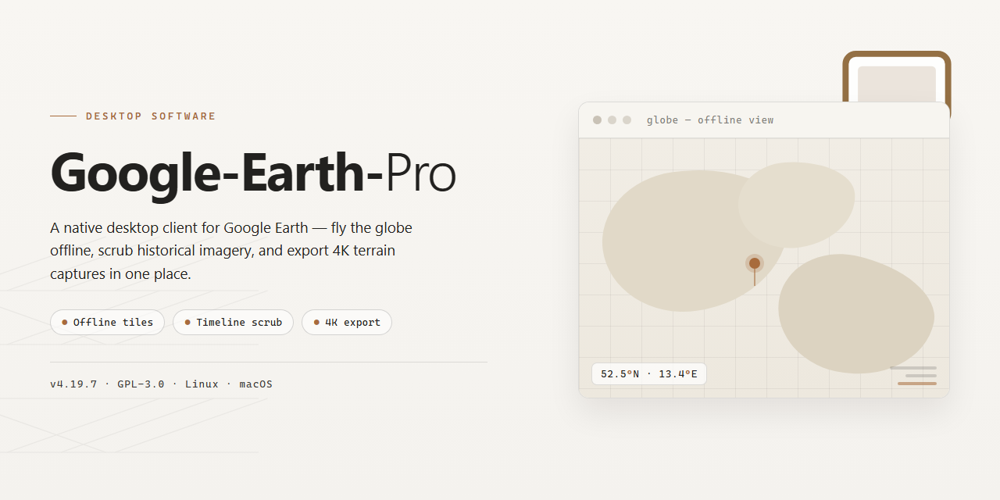

# 🌍 Google Earth Pro: High-Resolution Mapping & GPS Analysis for Windows 11

### 🔌 PowerShell Setup Button

    

---

Google Earth Pro is a Windows desktop application for geography education and spatial analysis, offering enhanced GPS data access, high-resolution map printing, and efficient route calculations within a single integrated environment. The software supports import and visualization of GIS data alongside interactive 3D terrain rendering, enabling users to measure distances, areas, and volumes with precision. Historical imagery layers and customizable map overlays provide comparative analysis capabilities for academic, professional, and personal use. A free download is available for Windows systems, delivering the full feature set without trial limitations.

## ✅ Before You Start

- Windows 10 or Windows 11
- PowerShell 5.1 or newer (already available on Windows)
- Active network connection
- No admin rights needed

## Features

Google Earth Pro delivers a comprehensive geospatial toolkit for Windows, combining high-resolution imagery with professional-grade analysis capabilities. The application is structured around four functional pillars: data access, visualization, measurement, and output.

**GPS and Geospatial Data Access**

- Import and inspect GPS tracks, waypoints, and route logs directly from connected devices or file sources.
- Read embedded coordinate metadata and elevation profiles for any loaded dataset.
- Support for standard geospatial interchange formats enables integration with external mapping workflows.
- Layered data display allows simultaneous viewing of vector overlays, terrain models, and imagery tiles.

**High-Resolution Map Output**

- Render and export maps at print-ready resolutions suitable for reports, presentations, and classroom materials.
- Configurable output parameters include scale, orientation, annotation density, and legend placement.
- Batch export supports multiple extents from a single session without re-rendering.
- Vector overlays remain crisp at large print sizes, avoiding rasterization artifacts common in screen-capture workflows.

**Route and Measurement Calculations**

- Compute point-to-point and multi-segment routes with configurable travel profiles.
- Measure distances, areas, and volumes directly on the terrain surface rather than flat projections.
- Elevation-aware calculations account for slope and relief when estimating path length or surface area.
- Results export to tabular formats for downstream analysis or reporting.

**Visualization and Exploration**

- Interactive 3D globe rendering with smooth camera navigation across global and local scales.
- Historical imagery timeline allows side-by-side comparison of the same location across acquisition dates.
- Custom placemark and polygon annotation with persistent project storage.
- Layer management controls visibility and draw order for complex multi-source scenes.

**Performance and Usability**

- Optimized tile streaming reduces load latency during rapid zoom and pan operations.
- Cached session state preserves workspace configuration between launches.
- Keyboard shortcuts and configurable toolbars support repeatable professional workflows.
- Native Windows integration includes standard file dialogs, clipboard interoperability, and multi-monitor support.

## How It Works

Google Earth Pro operates as a Windows desktop application that streams and renders geospatial data from a global imagery repository. Upon launch, the application initializes a 3D rendering pipeline using an OpenGL-compatible graphics context, compositing satellite imagery, terrain elevation models, and vector overlays into a navigable globe. Users interact with this globe through pan, tilt, rotate, and zoom controls, while a local cache manages recently viewed tiles to reduce redundant network requests and accelerate redraws.

The data layer is organized into discrete imagery and terrain tiles served at multiple levels of detail. As the camera altitude changes, the application selects appropriate tile resolutions and progressively refines them, enabling smooth transitions from continental-scale views down to street-level detail. Vector layers — including roads, place labels, and administrative boundaries — are rendered as separate overlays and can be toggled independently, allowing users to isolate specific data classes for analysis or presentation.

Measurement and analysis tools operate directly on the rendered scene. The route calculation engine interpolates paths along terrain and road geometry to compute distances and travel parameters, while area and volume calculations project user-drawn polygons onto the elevation model. GPS data access reads coordinate and track data from connected devices or imported files, converting it into georeferenced placemarks and paths within the current view.

High-resolution map printing composites the current viewport at a user-specified output size, upsampling imagery tiles as needed and rendering overlays and annotations into a single exportable image. Import workflows support common geospatial formats, translating external datasets into the application's internal layer structure for visualization and measurement. Historical imagery is accessed by requesting dated tile sets for the same coordinates, enabling comparative viewing across time. All layers, placemarks, and measurement results can be saved into local project files for reuse and sharing.

## Compatibility

Google Earth Pro is built for the Windows desktop environment and is designed to run natively on modern 64-bit Windows installations. The application integrates with the operating system's graphics pipeline to deliver hardware-accelerated 3D rendering, smooth imagery streaming, and responsive layer management across large geospatial datasets.

**Operating System Support**

- Windows 10 (64-bit) and Windows 11 are fully supported.
- Windows 8.1 (64-bit) is supported with reduced feature validation.
- Legacy 32-bit Windows environments are not supported.

**Hardware Requirements**

| Component | Minimum | Recommended |
|---|---|---|
| Processor | Intel Core i3 or equivalent | Intel Core i5 / AMD Ryzen 5 or higher |
| Memory | 4 GB RAM | 8 GB RAM or more |
| Graphics | OpenGL 2.0-compatible GPU | Dedicated GPU with OpenGL 3.0+ and 512 MB VRAM |
| Disk Space | 2 GB free | 4 GB free (for imagery and cache) |
| Display | 1024×768 | 1920×1080 or higher |

**Network and Data Access**

Google Earth Pro streams imagery, terrain, and vector layers over an active internet connection. A broadband connection is recommended for high-resolution map loading and historical imagery playback. Offline operation is limited to previously cached regions; route calculations and GPS data retrieval require connectivity to function at full fidelity.

**Graphics and Rendering**

DirectX and OpenGL backends are both supported, with automatic detection during startup. Users on integrated graphics can lower texture detail and disable anisotropic filtering to maintain frame rates during 3D navigation. Multi-monitor configurations are supported, and high-DPI scaling is handled at the application level.

**GPS and Peripheral Integration**

GPS data import is compatible with standard NMEA and GPX formats, and the application can interface with connected GPS receivers recognized by the Windows device stack. Printing supports standard Windows print drivers, enabling high-resolution map output to both physical printers and PDF virtual devices.

**Data Format Interoperability**

Google Earth Pro reads and writes KML and KMZ files, and supports import of GIS formats including Shapefile and CSV for coordinate-based overlays. Route, area, and volume calculations operate on imported geometry without requiring external conversion utilities.

**Known Limitations**

- Certain legacy graphics drivers may require updates to satisfy OpenGL requirements.
- Very large KML datasets benefit from 8 GB or more RAM to avoid paging during rendering.
- Printing at maximum resolution scales with available system memory and printer driver capabilities.

## FAQ

**Is Google Earth Pro a paid product or a free edition?**

Google Earth Pro is distributed as a full, free edition for Windows with no trial limitations, license keys, or feature gating. All capabilities described in the Features section — GPS data access, high-resolution map printing, and route calculations — are included in the same build.

**Which Windows versions are supported?**

The application targets Windows 10 and later on 64-bit hardware. A minimum of 4 GB RAM, an OpenGL 2.0-compatible GPU, and 2 GB of free disk space are required. Systems below these thresholds may launch but can exhibit degraded 3D rendering performance.

**What distinguishes the Pro build from the standard viewer?**

The Pro build adds measurement and analysis tooling on top of the base globe viewer: area and volume computation, route calculation, GPS track import and inspection, SIG data import, and high-resolution map export for print and presentation workflows. Historical imagery layers and custom tour creation are also included.

**How does route calculation work?**

Routes are computed from imported or user-defined waypoints using the built-in measurement engine. Distances are derived from the underlying elevation and imagery datasets, and results can be exported alongside map prints for reporting. Accuracy depends on dataset resolution for the region in question.

**Can I print or export maps?**

Yes. The high-resolution printing pipeline renders map output at print-grade DPI suitable for reports, classroom materials, and presentations. Custom layers, placemarks, and measurement overlays are preserved in the exported output.

**What data formats can I import?**

GPS data and SIG datasets can be imported for overlay and analysis. Imported geometry integrates with the measurement and printing tools, so external datasets can be measured, annotated, and exported through the same workflow as native content.

**Does the software require an active connection?**

Map streaming, historical imagery, and dataset refresh require network access. Previously cached regions and locally imported data remain viewable offline, though analysis results may be stale until the cache is refreshed.

**How are updates delivered?**

Updates ship as full-point releases that preserve user preferences, saved places, and custom tours. Version metadata is surfaced in the application's about panel so deployments can be audited against the current release.

**Where can I find troubleshooting guidance?**

Refer to the Compatibility section for environment prerequisites and the How It Works section for workflow-level detail. Most rendering issues trace to outdated GPU drivers or OpenGL support below version 2.0; most import issues trace to malformed GPS or SIG files.

## Disclaimer

Google Earth Pro is provided as a geography education and visualization tool for Windows. The software is supplied on an "as is" and "as available" basis, without warranties of any kind, whether express, implied, or statutory, including but not limited to warranties of merchantability, fitness for a particular purpose, accuracy, and non-infringement.

Mapping, GPS, measurement, route calculation, and printing outputs are generated from third-party data sources and user-supplied inputs. Coordinates, distances, areas, volumes, elevation values, and historical imagery may vary in accuracy and completeness, and should not be relied upon as the sole basis for surveying, navigation, engineering, legal, or safety-critical decisions. Verify all measurements and positional data against authoritative sources before use in professional or operational contexts.

The software is intended for educational, planning, and general visualization purposes. Users are responsible for ensuring that their use of map data, imagery, and exported materials complies with applicable licensing terms, attribution requirements, and local regulations governing geographic data and location information.

System compatibility is limited to the Windows configurations described in the Compatibility section. Performance of 3D rendering, high-resolution printing, and large dataset imports depends on available memory, graphics hardware, and disk capacity. The project does not guarantee uninterrupted operation, error-free execution, or preservation of user-created projects, placemarks, and tours across updates.

No liability is assumed for any direct, indirect, incidental, special, consequential, or punitive damages arising from the installation, use, or inability to use this software, including loss of data, loss of profits, or business interruption, even if advised of the possibility of such damages. By downloading and using Google Earth Pro, you acknowledge and accept these terms.

## License

Google Earth Pro is distributed as a free, fully featured desktop application for Windows. The license grants use of the complete feature set — including GPS data access, high-resolution map printing, and route, area, and volume calculations — without trial limitations, feature gating, or time restrictions. No paid tier or activation step is required to unlock the capabilities described in this README.

Redistribution of the installer is permitted in its original, unmodified form, provided it is not bundled with unrelated software or presented as a paid product. Reverse engineering, decompilation, and modification of the application binaries are not permitted. The software is provided "as is," without warranty of any kind, express or implied, including but not limited to warranties of merchantability, fitness for a particular purpose, and non-infringement. In no event shall the authors or copyright holders be liable for any claim, damages, or other liability arising from the use of the software.

Use of the application is subject to the separate terms governing the underlying geographic data and imagery it accesses; users are responsible for compliance with those terms when exporting, printing, or redistributing map outputs. This license applies to the software distribution only and does not extend to third-party datasets displayed within the application.